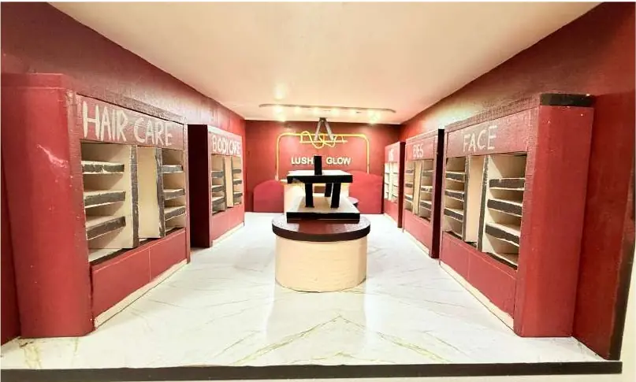
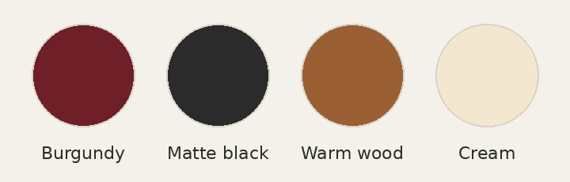
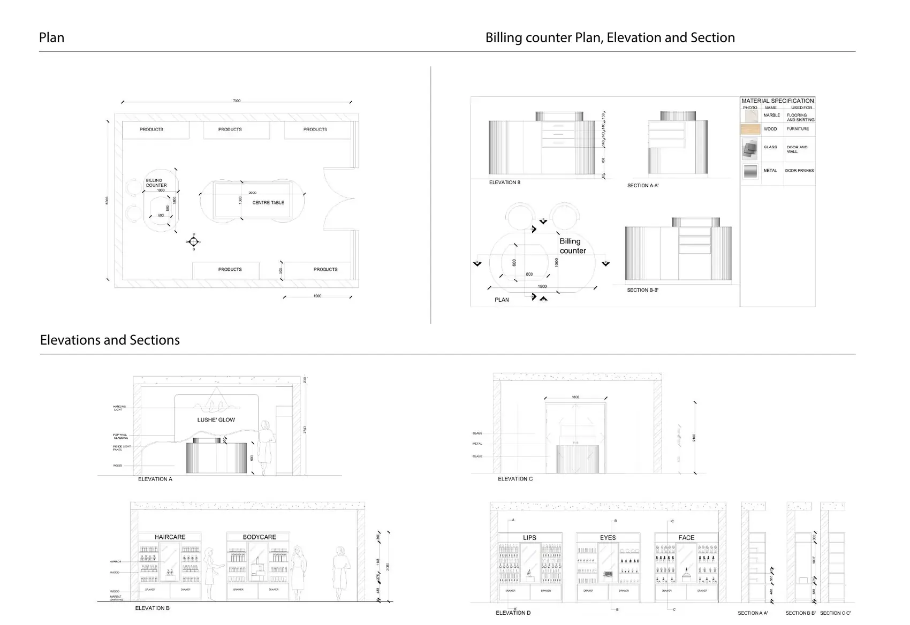
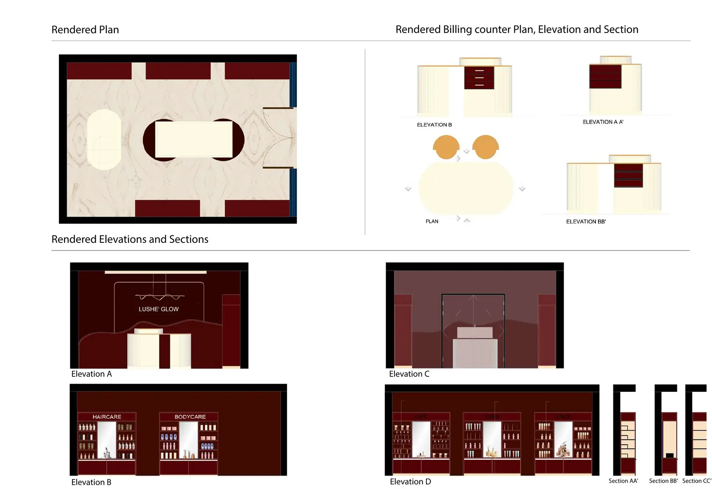
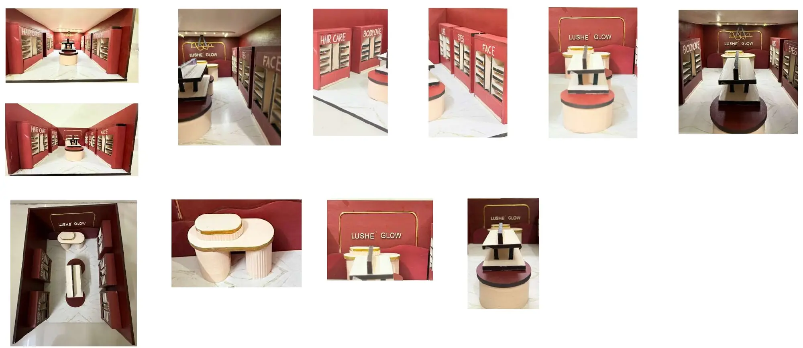

# Lushe’ Glow: Beauty retail store

*Skin, makeup, fragrance and self care*

Physical model of the store, central display and wall units

| | |
|---|---|
| **Semester / context** | Semester 4 |
| **Type** | Beauty retail store |
| **Case studies** | Nykaa, Sephora |
| **Focus** | Retail planning, product display, customer experience, lighting, materiality |
| **Key spaces** | Product display, central display, billing, storage, trial and mirror area |

## Design brief

A contemporary beauty store that feels inviting and easy to shop. The brief asked for clear product display, circulation, lighting, billing and storage, laid out so customers want to explore and interact with the products.

## Concept

Drawing on the retail experience of Nykaa and Sephora, the store pairs bold burgundy walls with a pale marble floor and a sculpted central display. Products are zoned by category, from haircare and bodycare to lips, eyes and face, so the room reads at a glance.

## Brand character

Modern and stylish, Positive, Approachable, Fresh and playful

## Colour palette

## Drawings and views

### Plan, billing counter details, elevations and sections

### Rendered plan, billing counter and elevations

### Model photographs

---

Designed by **Pankti Shah**, Bachelor of Design (Interior Design), Indus Design School, Indus University, Ahmedabad.

Full portfolio: [pankti1305.github.io](https://pankti1305.github.io)  
Contact: [pankti1305@gmail.com](mailto:pankti1305@gmail.com)
